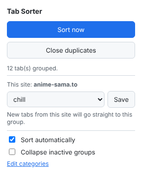
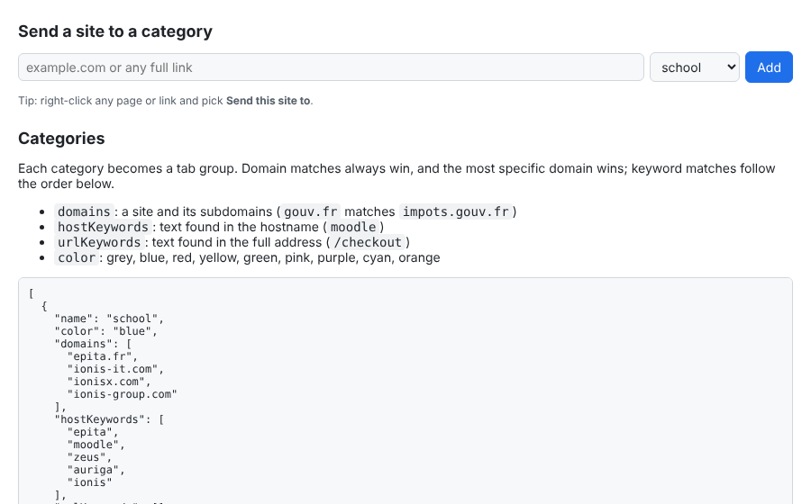

# Tab Sorter

A small Chrome extension that sorts your tabs into color-coded **tab groups** by category, automatically, as you browse.

Open YouTube and it lands in `chill`. Open a Root-Me challenge and it lands in `cyber`. Open a site it doesn't know, right-click, pick a group once, and every future tab from that site goes there too.

<p align="center">
  
</p>

## Features

- **Auto-sort**: every tab is grouped as soon as it loads a page.
- **Sort now**: one click (or <kbd>Alt</kbd>+<kbd>Shift</kbd>+<kbd>O</kbd>) groups every open tab and lays the groups out in order.
- **Teach it a site**: from the popup, the right-click menu (on a page *or a link*), or the settings page.
- **Never group**: keep chosen sites out of every group.
- **Close duplicates**: closes tabs whose URL is already open (keeps the active or pinned copy).
- **Collapse inactive groups** (optional): only the group you're in stays open.
- **Respects your setup**: pinned tabs and groups you created yourself are never touched.
- **Private**: no network requests, no analytics, no remote code. Everything stays in `chrome.storage.local`.

## Default categories

| Group | Color | Examples |
|---|---|---|
| `school` | blue | EPITA, Moodle, Zeus, Auriga, IONIS |
| `cyber` | purple | Root-Me, HackTheBox, TryHackMe, CTFtime, PortSwigger Academy, HackTricks, GTFOBins, CyberChef, Shodan |
| `dev` | green | GitHub, GitLab, Stack Overflow, MDN, PyPI, npm, `localhost` |
| `ai` | cyan | Claude, ChatGPT, Gemini, Perplexity, Mistral |
| `admin` | grey | `*.gouv.fr`, Ameli, CAF, banks, utilities, webmail |
| `shopping` | orange | Amazon, Vinted, Leboncoin, Fnac, parcel tracking, any `/checkout` or `/cart` page |
| `chill` | red | YouTube, Twitch, Netflix, Crunchyroll, anime-sama, Spotify, Steam |
| `social` | pink | Discord, Reddit, X, Instagram, WhatsApp Web |
| `jobs` | yellow | LinkedIn, Welcome to the Jungle, JobTeaser, Indeed |

The defaults lean French (government sites, banks, retailers). Rename, recolor, add or delete categories from the settings page.

## Install

Tab Sorter isn't on the Chrome Web Store, so you load it as an unpacked extension. It takes about a minute.

1. Download this repo (**Code → Download ZIP**, then unzip) or `git clone` it.
2. Open `chrome://extensions`.
3. Turn on **Developer mode** (top right).
4. Click **Load unpacked** and select the **`extension`** folder.
5. Pin the icon from the puzzle-piece menu, then click **Sort now**.

Keep the folder where it is: Chrome reads the extension from it. To update, pull or replace the files, then click the reload arrow on the extension's card. Your settings are kept.

Works in any Chromium browser with tab groups (Chrome, Edge, Brave, Opera).

## How matching works

Each category has three optional lists:

| Field | Matches | Example |
|---|---|---|
| `domains` | the site and all its subdomains | `gouv.fr` matches `impots.gouv.fr` |
| `hostKeywords` | text anywhere in the hostname | `moodle` matches `moodle.uni.edu` |
| `urlKeywords` | text anywhere in host + path + query | `/checkout` |

A URL is checked in this order:

1. **Never group** list: if it matches, the tab stays ungrouped.
2. **Domains**: the most specific match wins across all categories, so `cyber.gouv.fr` (cyber) beats `gouv.fr` (admin).
3. **Host keywords**, in category order.
4. **URL keywords**, in category order.

Category order is also the order groups are laid out in after **Sort now**.

## Customize

Open **Edit categories** in the popup (or right-click the icon → **Options**).

- **Send a site to a category**: paste a domain or any link, pick a group, click **Add**. The site is removed from any other category, and its open tabs move right away.
- **Categories**: the full rule set as JSON. Edit, then **Save**.
- **Never group**: one domain per line.
- **Restore defaults** resets categories and the ignore list.

<p align="center">
  
</p>

## Permissions

| Permission | Why |
|---|---|
| `tabs` | read tab URLs to pick a category, close duplicates |
| `tabGroups` | create, name, color, move and collapse groups |
| `storage` | save your categories and settings locally |
| `contextMenus` | the right-click **Send this site to** menu |

No host permissions, no content scripts: the extension never reads page content.

## Project layout

```
extension/
  manifest.json      Manifest V3
  background.js      service worker: grouping, auto-sort, menus, messages
  popup.html/js      toolbar popup
  options.html/js    settings page
  ui.css             shared styles (light + dark)
  lib/
    defaults.js      default categories
    matcher.js       pure matching logic (no Chrome APIs, unit-tested)
    storage.js       chrome.storage helpers
  icons/
tests/
  matcher.test.js
```

## Development

Requires Node 18+ for tests only. There are no dependencies and no build step.

```bash
npm test          # run unit tests (node:test)
npm run package   # zip the extension folder into tab-sorter.zip
```

After editing files, click the reload arrow on the extension's card in `chrome://extensions`. Service-worker logs are under **Inspect views: service worker** on the same card.

## License

[MIT](LICENSE)
